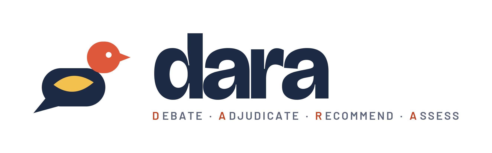

<p>
  
</p>

<p><i>dara</i> — dove. Crisis negotiation rehearsal.</p>

---

Before entering a negotiation, a policymaker needs to anticipate what the other
side will refuse and what it will trade. DARA builds a model of each party from
its documented positions, simulates the negotiation between language-model
agents, and scores the outcome against the best settlement that was actually
available.

**Intended user:** a policymaker on the advised country's negotiating team.

## Two ways in

| | **Policymaker** — rehearse a negotiation | **Researcher** — answer the research question |
|---|---|---|
| Asks | What should I open with? What will they push back on? | Does debate with a judge (B2) beat one model call (B0)? |
| Gives | Rankings and good / acceptable / unacceptable | Nothing — runs the fixed study set |
| Command | `rehearse` | `experiment` |
| Cost | Free and instant, no key | Shown before spending; `--live` to spend |

The two never mix. The policymaker features are never used to score the
research question, and crises entered through the form never join the study set
(CONTRACT.md §15).

### Policymaker: rehearse in thirty seconds

```bash
cd backend
python -m crisis_debate.cli rehearse haze_real                          # the best openings
python -m crisis_debate.cli rehearse haze_real --open "enforcement=joint asean panel"  # what if?
python -m crisis_debate.cli rehearse --form examples/haze_form.json     # your own crisis
```

**Your own crisis needs no numbers.** `examples/haze_form.json` shows the whole
form: name the two sides, list what is on the table, rank the issues for each
side, and mark each option *good*, *acceptable* or *unacceptable*. DARA reads it
back to you in sentences before using it (the review step), then turns it into
weights. Ranks become weights by rank-order centroid; good, acceptable and
unacceptable become 1, 0.5 and 0. Unacceptable options become red lines that are
never crossed. Over HTTP this is `POST /api/intake`: a preview first, then
`"confirm": true` saves it.

**What `rehearse` does is a world model: imagine before acting.** Before a word
is said in the room, it imagines 64 plausible versions of the other side. Your
read of their priorities is a guess, so each version varies it by ±20%. For each
version it predicts whether they accept your opening and, if not, the smallest
counter-offer they would make on their own terms. You get back:

- how often they accept;
- what they push back on;
- their likely counter;
- where you are likely to land;
- a warning when you could end up worse off than splitting the difference, or
  with no deal at all.

On the haze case, asking for everything lands you at 64% of your best case. The
planned opening lands at 73%. Over HTTP this is
`POST /api/scenarios/<id>/imagine`.

`run` is the high-fidelity version of the same idea: language-model agents
arguing the negotiation out in prose.

### Researcher: answer the question in one command

The full procedure — setup, the order to run things in, how to read the
results file, and a reporting template — is in [EVALUATION.md](EVALUATION.md).

```bash
python -m crisis_debate.cli experiment             # prints the plan and its call count, runs nothing
python -m crisis_debate.cli experiment --dry-run   # the whole pipeline with scripted agents, free
python -m crisis_debate.cli experiment --live      # B0/B1/B2 × 2 cases × 3 repeats ≈ 116 calls
```

One run produces everything a reported number has to carry (CONTRACT.md
§13.4–13.6):

- every condition scored on the declared RQ recommendation;
- both pre-declared primaries side by side;
- call counts beside every comparison;
- judge self-consistency, position bias and validity;
- a ±20% stress band on each recommendation;
- agreement with history across conditions, flagged as contaminated.

Results go to `backend/results/`.

## Several recommendations, not one

A crisis has no single right settlement, because *right* depends on what you are
protecting. The settlement that minimises deaths is often not the one that
minimises cost, and a system that returns one answer has quietly made that choice
on the user's behalf.

So a run produces **one recommendation per priority**. You pick who you are and
what the advice should protect — harm to people, finance, time to agreement,
fairness of the split, jurisdiction — and each recommendation arrives with its
own headline, its own reasoning, and its own opening package, scored separately
against the same frontier.

On the haze case, the two default priorities genuinely diverge:

| Prioritising | Opening package | Joint value recovered | Nash |
|---|---|---|---|
| Harm to people | full disclosure · joint panel · no exemptions · **full fund** | 96.9% | 0.90 |
| Finance | district maps · joint panel · partial exemptions · **partial fund** | 77.2% | 0.60 |

The gap between those rows is the actual advice: buying the faster end of the
haze costs money, and how much that is worth is a political judgement that
belongs to the reader, not to the model. When two priorities *do* select the same
package, the run reports `priorities_diverged: false` rather than hiding it —
that is a finding about the crisis, not a fault.

The debate itself runs once. Only the advice built from it is tailored, so a
difference between two recommendations is attributable to the priority rather
than to the parties having argued differently.

The crisis is posed as a multi-issue bargaining problem: four issues with
discrete settlement levels and a **private** utility function per party. Every
proposal therefore maps to a point in outcome space with an exactly enumerated
Pareto frontier — so "a better recommendation" means *recovered more of the
available joint value*, not *read better*.

## Layout

```
CONTRACT.md         what this tool is for, and what is out of scope
backend/
  crisis_debate/    the pipeline
  app.py            the HTTP API over it (Flask)
  eval/<case>/      INPUT — the study set: scenario.json + ground_truth.json
  examples/         a crisis written as the plain-language form
  results/          experiment output (gitignored)
  demo/             OUTPUT — recorded runs, replayable without a key
  tests/            no API key and no network required
docs/               build plan and the contamination report
brand/              logo and palette
frontend/           the web console — plain JS, served by `node server.js`
```

### `eval/` vs `demo/`

These are easy to confuse and they are opposites.

An **eval case** is the *input*. `backend/eval/<case>/` holds `scenario.json`
and, where the negotiation is a historical one, the `ground_truth.json` it is
scored against. Nothing in `eval/` is model-generated.

The `scenario.json` is the problem itself, as it stands before anyone argues
about it: who the parties are, which issues are on the table, what options each
issue can settle at, and each party's **private** valuation of those options. It
contains no debate, no agent text and no outcome. This is exactly what the
add-crisis form produces — a crisis you add is the same kind of object as a
bundled one, validated by the same Pydantic models and written to the same
folder.

A **demo** run is the *output*, and is entirely model-generated. It is one
complete recorded run of the pipeline over a scenario, down to each agent's individual response: every turn's
prose, the package it proposed, each judge's per-criterion scores and summary,
one recommendation per priority, and the latency of each call. It exists so a
debate can be replayed exactly, at no cost, when no key is present.

So: `eval/haze_real/scenario.json` is *the haze dispute*.
`demo/haze_real.json` is *one argument that happened about it*. Deleting the
recording loses a transcript; deleting the scenario loses the problem.

## Setup

Python 3.11 or newer. Nothing else is required — no key, no network, no Node.

```bash
git clone <this repo> && cd dara

python3 -m venv .venv
source .venv/bin/activate                  # Windows: .venv\Scripts\activate
pip install -r backend/requirements.txt
```

### Check it works

```bash
cd backend
pytest -q                                  # 195 tests, no key and no network
```

Run everything from `backend/`. `pytest.ini` puts the package on the path, and
the `eval/` and `demo/` folders resolve relative to it.

### Use it from the command line

```bash
python -m crisis_debate.cli scenarios      # what's bundled
python -m crisis_debate.cli rehearse haze_real   # best openings, imagined, instant
python -m crisis_debate.cli experiment     # the research question; plan and cost first
python -m crisis_debate.cli providers      # would this run be live or cached?
python -m crisis_debate.cli run --scenario haze_real --condition B2
```

`providers` answers "am I about to spend money?" before you run anything.

### Use it over HTTP

```bash
python app.py                              # from backend/
```

It serves on `http://127.0.0.1:8000`. That address is bound explicitly rather
than as `localhost`, because a server that binds only the IPv6 loopback is
unreachable at `127.0.0.1` — which is how an earlier setup failed to open.

- `GET /api/health` — says whether the next run will be live or recorded
- `GET /api/scenarios` — the bundled crises with their frontier statistics
- `POST /api/scenarios/<id>/imagine` — the best openings, or `{"opening": {...}}`
  for a what-if; instant, no model call
- `POST /api/intake` — the plain-language form: preview and review, then
  `"confirm": true` to save
- `GET /api/run?scenario=haze_real&condition=B2&priorities=casualty_minimisation,cost`
  — streams the debate as server-sent events, one per turn, one `recommendation`
  per priority

```bash
curl -N "http://localhost:8000/api/run?scenario=haze_real&condition=B2&rounds=3"
```

### Live vs recorded

```bash
cp .env.example .env                       # then set OPENAI_API_KEY
```

With a key, runs call the model. Without one, they replay the recorded runs in
`backend/demo/` — the same pipeline, at zero cost, which is how the tests work.

The choice is made in one place and always reported: `/api/health` says which way
the next run will go, the CLI prints it, and every streamed event carries a
`mode` field. A recorded run cannot be mistaken for a live measurement because
the answer travels with the data.

## The pipeline

| Stage | What it does |
|---|---|
| briefs | Each party gets its interests, red lines and its own private valuations |
| frontier | Every settlement is enumerated and scored *before* any agent runs, so the yardstick cannot move to fit the result |
| debate ×3 | Each party argues and commits to a concrete package, seeing only its own valuations |
| judge | Scores both arguments 1–5 on five criteria. Holds no brief, sees no valuations |
| recommender | Builds the advice from the judge's scores only — the transcript is withheld. Runs once per priority |
| scoring | Each recommended package against the frontier |

Three conditions: **B0** one call, no debate · **B1** debate without a judge ·
**B2** the full system. Call counts are reported alongside every result, so the
budget difference between them is visible.

## Design invariants

Four rules the tests enforce, because breaking any of them quietly invalidates
the results:

1. **The recommender never sees the transcript in B2.** Enforced by the function
   signature having no parameter for it. Remove the barrier and B1 isolates
   nothing and the judge becomes decorative.
2. **Country agents differ only by their brief.** One prompt template; a test
   masks each brief out and asserts the remaining skeletons are identical.
3. **Private valuations never reach an opponent, and never reach the judge.**
4. **Illegal packages are recorded, never coerced.** Snapping an out-of-range
   option to the nearest legal one would change the utility vector and corrupt
   every efficiency number computed from it.

## Cases

Two are built; `docs/build_plan.md` §3 lists the ten planned.

| Case | Parties | B2 | B0 |
|---|---|---|---|
| Transboundary haze, 2015–16 | Singapore · Indonesia | 96.9% of joint value | 74.4% |
| COVID-19 border and supply, 2020 | Singapore · Malaysia | 100% | 56.7% |

## A limitation you should read before citing anything

Both cases are **hand-authored, not extracted from documents**, and the
contamination audit in `docs/CONTAMINATION.md` shows what that costs. Agent
output is clean — no post-cutoff facts are recalled — but the *issue sets* carry
hindsight: `peatland_moratorium` and `stay_in_singapore_with_support` are both
datable after their evidence cutoffs, and both were chosen by an author who knew
how the negotiations ended.

A leak scan cannot detect this, because a term written into the issue set counts
as supplied by construction. Until the issue sets are derived from pre-cutoff
documents by the extraction layer, any backtest on these cases is illustrative
rather than evidential.

Recorded agent turns were generated by a language model and are labelled as such
in each file's provenance field. They are not transcripts of real negotiations.

## Status

Built: payoff layer, three conditions, recommendations tailored per audience and
priority, three-layer versioned briefs with provenance, situational signals
(GDACS and World Bank verified live), extraction, the contamination audit, and
the HTTP API — scenario listing, settlement scoring, scenario creation and the
streaming run endpoint.

The **web console** (`frontend/`) is plain browser JavaScript with no build
step. It defaults to a policymaker view (the add-crisis form, imagined openings,
"Hear them argue it"); a header switch opens the full research view. Run the
API, then:

```bash
cd frontend && node server.js              # http://127.0.0.1:3000, proxies /api to :8000
```

Partly built: **add-crisis**. The API accepts a new crisis at `POST
/api/scenarios`, validates it with the same models the bundled cases use, and
writes a real scenario file that is immediately runnable. Extraction — turning
pasted documents into a sourced issue set — is the one step not wired up: it is
a model call, so the flow says so rather than inventing a brief.

Not built: cases 3–10, which wait on extraction running against real documents.
`docs/build_plan.md` §2 lists what needs a human.
